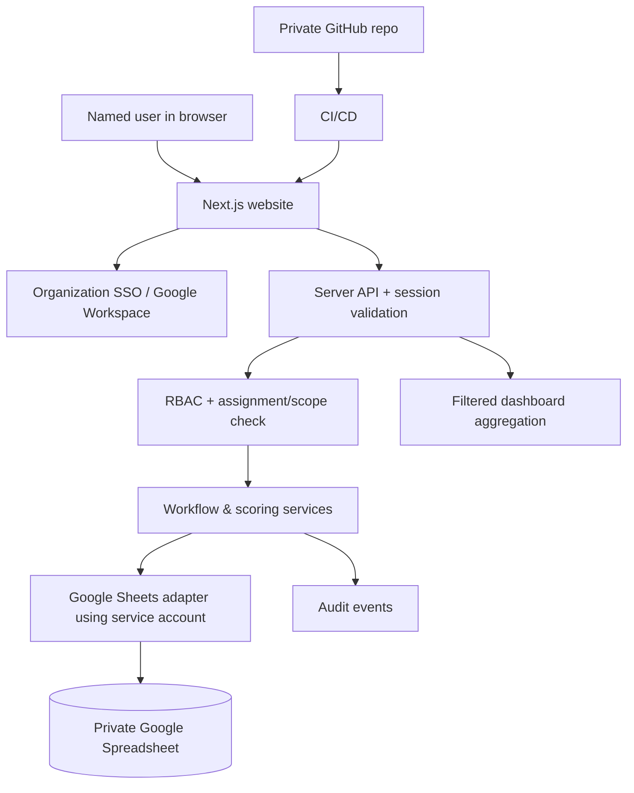

# Employee Assessment Workflow Platform

> Architecture & Cursor implementation specification — Version 2.0 (Google Sheets–backed)
> Status: implementation blueprint; not a production security certification.

## 1. Goal

Build a responsive, easy-to-use assessment website for approximately 200 employees. Employees complete self-assessment, direct managers read those submissions and evaluate, assigned committee members review both and finalize, and executives see a permission-filtered dashboard. The website is the sole normal input and review interface; Google Sheets stores structured assessment data. GitHub stores source code and CI/CD configuration, **not private assessment responses**.

### Non-negotiables
- Login uses named individual accounts mapped to a unique employee ID. Never identify users by an editable name, client-supplied ID or URL parameter alone.
- Every read/write is authorized on the server: employee self only; manager's assigned reports only; committee's assigned cases only; executive permitted scopes only; HR/admin administrative operations.
- No browser-to-Sheets direct access; no Google API credential, Sheets token or service account key in browser JavaScript.
- Each submission creates durable records, submit lock and audit evidence. Failed/duplicate requests must not create duplicate submissions.
- Dashboard uses **finalized, published** cases by default; never silently mix draft, intermediate and finalized scores.
- Forms and scoring are versioned by evaluation cycle. Changing questions later cannot rewrite the meaning of previously submitted answers.
- Show development priorities; do not treat rankings as definitive measures of employee worth.

## 2. Recommended technology and deployment

| Layer | Recommended for initial implementation | Rationale |
|---|---|---|
| Website | Next.js App Router, TypeScript, Tailwind CSS, shadcn/ui, React Hook Form, Zod | Responsive and modular; suitable for Cursor |
| Auth | Google Workspace OIDC via Auth.js or enterprise SSO (confirm enterprise policy) | Verified identity + named users; enforce MFA at identity provider |
| API | Next.js Route Handlers running server-side | Central auth/authorization, validation, workflow, audit |
| Data | Google Sheets API via a dedicated service account with least privilege | Single spreadsheet for proof-of-concept for 200 users |
| Hosting | Managed Node.js hosting that supports server secrets, HTTPS, logs, deployment | No secrets on client |
| Source / CI | Private GitHub repository + GitHub Actions | Build, tests and deployment; not an employee record store |

**Alternative:** Google Apps Script web app may be used as an API adapter, but *do not* expose an anonymous deployment or put secret tokens in the browser. It still needs a reliable server-side authentication and authorization strategy. For production-grade HR-sensitive data, evaluate a managed relational database with Google Sheets as a reporting export instead; Sheets has limited transactional integrity, concurrency guarantees and fine-grained access control.

### Architecture



## 3. Personas and access matrix

| Role | Own self | Team self | Team manager scores | Committee cases | Company dashboard | Manage users/questions |
|---|---:|---:|---:|---:|---:|---:|
| EMPLOYEE | Read/write until submitted | No | No, unless release policy | No | No | No |
| MANAGER | As employee | Read for assigned direct reports after self-submit | Read/write own manager reviews | No | Team aggregate if allowed | No |
| COMMITTEE | As employee (if applicable) | Assigned case self + manager scores | Assigned case scores | Read/write assigned cases | No by default | No |
| EXECUTIVE | Optional | Scoped read by company/group/team | Scoped read per policy | Final only by default | Scoped, published data | No |
| HR_ADMIN | Scoped administrative read | Scoped administrative read | Scoped administrative read | Scoped administrative read | Scoped | Manage cycles, roster, assignment, publishing |
| SYSTEM_ADMIN | Infrastructure only by default | No automatic HR content access | No automatic HR content access | No automatic HR content access | No automatic content access | Technical admin only |

Rules:
1. Authorization checks MUST live in server services and apply to each case, not just to pages.
2. Manager's assignment is effective-dated and frozen/snapshotted for a cycle as needed.
3. Committee members must be assigned to cases; any committee member who is the employee or has a conflict is excluded/recused.
4. Executive drill-down to identifiable employee data is a separate scope from aggregate reporting. Require explicit permission.
5. Small groups can expose identities through aggregation. Set a configurable privacy threshold (e.g. no aggregate for fewer than 5 people), with separately authorized exception handling.
6. Employee visibility of manager/committee evaluations must be controlled by a formal HR release policy; do not show prematurely.

## 4. Cycle and status state machine

Stages are sequential and cannot be skipped by ordinary role actions:

`NOT_STARTED` → `SELF_DRAFT` → `SELF_SUBMITTED` → `MANAGER_DRAFT` → `MANAGER_SUBMITTED` → `COMMITTEE_IN_REVIEW` → `FINALIZED` → `PUBLISHED`

Possible controlled transitions: `RETURNED_TO_SELF`, `RETURNED_TO_MANAGER`, `CANCELLED`, `REOPENED_BY_HR`. Each requires reason, actor, timestamp and audit record; never delete historical submitted versions. HR opens/closes cycles and sets stage deadlines. A manager cannot submit before employee self-submits. Committee cannot finalize until manager submits. Executives see only `PUBLISHED` by default; optionally show progress counts for all statuses without exposing unpublished scores.

### Score treatment
- Keep `self`, `manager`, and `committee` scores **separate**. Do not overwrite earlier scores.
- Committee may provide an independent final rating and an explanation of significant differences.
- Default report shows committee-final score as the final official score; any weighted formula requires explicit HR-approved policy and a versioned definition.
- Never infer potential from performance automatically. A 9-box requires independently defined performance and potential dimensions with explicit calibration.
- Score normalization: category score = weighted mean of answered items that are scorable and required under that version; missing required questions block submit. Not-applicable requires a defined scoring policy.

## 5. Google Spreadsheet schema

Use one PRIVATE spreadsheet per environment (dev/test/prod). Service account access only for the API. In production, HR users should not freely edit response sheets; provide controlled admin actions or protected ranges. Human-readable reports may be exported to separate read-only workbooks.

| Tab | Key columns | Purpose |
|---|---|---|
| `Users` | `user_id, employee_code, email, display_name, active, created_at` | Named identities; email matches verified IdP claim |
| `OrgUnits` | `org_unit_id, group_id, team_id, name, parent_id, active` | Company/group/team hierarchy |
| `Memberships` | `user_id, org_unit_id, manager_user_id, valid_from, valid_to` | Reporting lines and historical scope |
| `RoleAssignments` | `assignment_id, user_id, role, scope_type, scope_id, cycle_id, active` | Role and scope |
| `Cycles` | `cycle_id, name, starts_at, self_deadline, manager_deadline, committee_deadline, published_at, status` | Review rounds |
| `FormVersions` | `form_version_id, role, cycle_id, version, schema_json, scoring_config_json, frozen_at` | Editable draft, frozen published versions |
| `Cases` | `case_id, cycle_id, employee_user_id, manager_user_id, status, self_form_version_id, manager_form_version_id, committee_form_version_id, updated_at, version` | Single case per employee per cycle |
| `CommitteeAssignments` | `case_id, reviewer_user_id, status, conflict_declared_at` | Only assigned committee reviewers access cases |
| `Responses` | `response_id, case_id, stage, evaluator_user_id, question_id, answer_json, form_version_id, draft_revision, updated_at` | Normalized answers |
| `Submissions` | `submission_id, case_id, stage, evaluator_user_id, score_json, submitted_at, revision, idempotency_key` | Immutable submitted snapshots |
| `FinalResults` | `case_id, cycle_id, final_score, performance_score, potential_score, talent_segment, decision_note, finalized_at, published_at, result_version` | Official result and release |
| `DevelopmentPlans` | `plan_id, case_id, owner_user_id, skill_gap, action, due_at, status, review_at` | Development tracking |
| `AuditLog` | `event_id, actor_user_id, case_id, action, stage, old_status, new_status, timestamp, request_id, metadata_json` | Append-only audit trail |

- Prefer stable UUIDs for IDs; never rely on row number as an ID.
- Include server-side ETag/version or monotonic version for optimistic concurrency checks; Sheets does not provide true transactions, so serialize conflicting writes and verify before/after for safety.
- Prevent formula injection: encode untrusted strings before writing as sheet cells. Store JSON with safe serialization and never interpret user text as formulas.
- Protect spreadsheet sharing, use least-privilege service accounts and rotate credentials according to company policy.
- Use scheduled encrypted backups/exports with restore tests. AuditLog in Sheets is insufficient against an editor changing history; send a second immutable audit stream to a restricted logging service for production.
- Document retention, deletion, employee access rights, access logging and legal basis with HR/legal under PDPA.

## 6. Example questionnaire configuration

All questions below are **mock content** only, not an approved HR instrument. `FormVersions.schema_json` may contain the following JSON, with each stage having its own form. Do not hard-code question labels in components.

```json
{
  "formId": "self-review-2026",
  "version": 1,
  "stage": "SELF",
  "title": "แบบประเมินตนเอง (ตัวอย่าง)",
  "sections": [
    {
      "id": "competency",
      "title": "สมรรถนะในการทำงาน",
      "questions": [
        {"id":"s01","type":"rating","label":"คุณภาพของผลงาน","required":true,"min":1,"max":5,"weight":1,"dimension":"performance"},
        {"id":"s02","type":"rating","label":"การทำงานร่วมกับผู้อื่น","required":true,"min":1,"max":5,"weight":1,"dimension":"collaboration"},
        {"id":"s03","type":"rating","label":"ความสามารถในการเรียนรู้สิ่งใหม่","required":true,"min":1,"max":5,"weight":1,"dimension":"learning"},
        {"id":"s04","type":"rating","label":"การแก้ปัญหาและตัดสินใจ","required":true,"min":1,"max":5,"weight":1,"dimension":"problem_solving"}
      ]
    },
    {
      "id":"growth",
      "title":"แผนพัฒนา",
      "questions":[
        {"id":"s05","type":"textarea","label":"ผลงานที่ภาคภูมิใจพร้อมตัวอย่าง","required":true,"maxLength":3000},
        {"id":"s06","type":"multi_select","label":"ทักษะที่อยากพัฒนา","required":true,"options":["การสื่อสาร","การใช้เทคโนโลยี","การวิเคราะห์ข้อมูล","ภาวะผู้นำ","อื่น ๆ"]},
        {"id":"s07","type":"textarea","label":"สิ่งที่ต้องการให้หัวหน้าช่วยสนับสนุน","required":false,"maxLength":3000}
      ]
    }
  ]
}
```

Manager form mock: rating performance, delivery, teamwork, growth; textual evidence, strengths, development areas, support action. Committee form mock: review three earlier submissions, independent final rating, performance and potential **each defined by distinct criteria**, rationale, recommendation, recusal declaration. Form builder should support `rating`, `single_select`, `multi_select`, `textarea`, `number`, `date`, `section`, `conditional` question visibility, validations, required flags, evidence text, and weight only for scorable items.

### Questionnaire pages and interactions

**Employee `/my-assessment/[caseId]`**
- Header: name, cycle, deadline, submission status, save draft / submit.
- Progress sidebar or stepper for form sections; each section displays required remaining.
- Rating cards with 1–5 labels (anchored rubric) and keyboard accessibility.
- Open answers with guidance, character counter and validation.
- Save draft; review answers; submit confirmation and receipt ID; submitted form becomes read-only.

**Manager `/team/reviews/[caseId]`**
- Left pane: employee's submitted self-evaluation (read-only, with evidence).
- Right pane: manager's independent questions, ratings, comments, save draft.
- Difference visualization per dimension without forcing manager to match self-ratings.
- Submit confirmation; lock manager submission; advance to committee queue.

**Committee `/committee/cases/[caseId]`**
- Read-only self and manager evaluations, score differences and supporting evidence.
- Independent score form and qualitative recommendation; conflict-of-interest checkbox/recusal.
- If multiple committee reviewers: define aggregation/consensus rule and who can finalize before implementation.
- Finalization confirmation; then separate HR publish action.

**Executive `/executive`**
- Company-wide → group → team → employee drill-down, permission filtered.
- KPIs: published cases, assessment completion counts, final score mean/median, scores by group/team, trends across equivalent cycles, score disagreement self vs manager vs committee, distribution, development needs, overdue tasks.
- Segmentation: chosen approved scoring bands and optionally 9-box only if both independent dimensions exist; show definition and period.
- Display denominators (`N`), cycle, published-only filter and suppression for small groups; differentiate trend from organizational composition changes.
- Export only under authorized server endpoint with watermark/audit trail.

**HR Admin `/admin`**
- User and team import (CSV), duplicate checks and invalid-email preview.
- Role/manager/committee assignments; evaluation cycle setup.
- Form builder: draft → preview → publish/freeze → version; test with fake users.
- Cases: deadlines, status, reopen with rationale, anomalies, publish approval.
- Audit/event history, export reports, backups and operations overview.

## 7. Endpoints (server only)

| Method | Endpoint | Purpose / authorization |
|---|---|---|
| GET | `/api/me` | Identity, roles, allowed scopes |
| GET | `/api/cycles/current` | Active cycle metadata |
| GET | `/api/forms/:stage?cycleId=` | Authorized published form version |
| GET | `/api/my/cases` | Signed-in user's cases |
| GET | `/api/cases/:id` | Case details with role-specific field redaction |
| PUT | `/api/cases/:id/draft` | Draft response, stage ownership, optimistic version |
| POST | `/api/cases/:id/submit` | Validate frozen form + stage + idempotency key |
| GET | `/api/manager/cases` | Assigned direct reports only |
| GET | `/api/committee/cases` | Assigned cases only |
| POST | `/api/cases/:id/finalize` | Authorized committee finalizer only |
| POST | `/api/cases/:id/publish` | HR approval, audit and release |
| GET | `/api/dashboard/summary?cycleId=&scope=` | Executive scoped aggregate, published-only |
| GET | `/api/dashboard/drilldown?cycleId=&scope=` | Scoped detail, extra permission and small-N checks |
| GET/POST | `/api/admin/forms` | Draft/edit/preview; freeze published version |
| POST | `/api/admin/import/users` | Admin validated CSV import |
| GET | `/api/admin/audit` | Restricted audited operations |

Implement Zod parsing, central `assertCan(action, actor, case, scope)`, anti-CSRF protection as applicable, rate limiting, structured errors, secure cookies, zero PII in client/server error logs, and redacted analytics. Do not accept actor ID, role or group ID from client as a trusted source. Passwords should not be stored in Sheets. Provide stable request IDs and idempotency keys.

## 8. Front-end routes and file structure

```text
employee-assessment/
├── README.md
├── .env.example                   # variable names only; NO secrets
├── .gitignore
├── next.config.ts
├── package.json
├── prisma/                       # reserved for future DB migration (optional)
├── docs/
│   ├── PRODUCT_SPEC.md
│   ├── SECURITY.md
│   ├── DATA_DICTIONARY.md
│   ├── WORKFLOW.md
│   └── DEPLOYMENT.md
├── src/
│   ├── app/
│   │   ├── (auth)/login/page.tsx
│   │   ├── (employee)/my-assessment/[caseId]/page.tsx
│   │   ├── (manager)/team/reviews/page.tsx
│   │   ├── (manager)/team/reviews/[caseId]/page.tsx
│   │   ├── (committee)/committee/cases/page.tsx
│   │   ├── (committee)/committee/cases/[caseId]/page.tsx
│   │   ├── (executive)/executive/page.tsx
│   │   ├── (admin)/admin/forms/page.tsx
│   │   ├── (admin)/admin/cycles/page.tsx
│   │   ├── (admin)/admin/users/page.tsx
│   │   └── api/...
│   ├── components/
│   │   ├── assessment/{FormRenderer,RatingQuestion,TextQuestion,FormStepper,SubmissionConfirm}.tsx
│   │   ├── review/{SelfComparison,ManagerReview,CommitteeDecision}.tsx
│   │   ├── dashboard/{KpiCards,ScoreDistribution,TrendChart,OrgDrilldown,TalentMatrix}.tsx
│   │   └── ui/...
│   ├── config/mock-forms/{self,manager,committee}.json
│   ├── lib/
│   │   ├── auth/
│   │   ├── permissions/{roles,scopes,policy}.ts
│   │   ├── workflow/{states,transitions}.ts
│   │   ├── forms/{schema,validator,scoring}.ts
│   │   ├── sheets/{client,adapter,columns,serialization}.ts
│   │   ├── services/{cases,submissions,dashboard,audit}.ts
│   │   └── validation/
│   └── types/
├── scripts/
│   ├── setup-sheets.ts
│   └── seed-demo-200.ts            # TEST spreadsheet only
└── tests/
    ├── permissions.test.ts
    ├── workflow.test.ts
    ├── scoring.test.ts
    ├── concurrency.test.ts
    └── e2e/
```

## 9. Dashboard decision-oriented specification

Top filter bar: review cycle; business group; team; compare cycle (only same rubric unless normalized). Cards: total employees in scope, self submitted, manager submitted, committee finalized, published, overdue; completion rate and published count. Charts: published score distribution, trend, cross-stage score gap, group and team comparison (suppress small N), top development needs, action plan completion, optionally calibrated matrix. Drill-down: company → group → team → person when separately permitted. Show N, period and interpretation caveats on charts. Only scores from published results count in performance distributions.

## 10. UI design guidelines

Theme: contemporary HR SaaS, clean, responsive, generous spacing; light background, navy text, restrained teal accent. Left sidebar per role, clear page heading, action bar, breadcrumbs. Dashboard card grid and contextual drill-down. Questionnaire uses large readable rating controls, autosave status, step navigation, review and confirmation screen. Status labels with both text and color (not color only), keyboard support, Thai-first UI, explicit time zone (`Asia/Bangkok`), mobile-friendly forms and desktop dashboard. Loading/empty/error/no-permission/conflict states in every module. Avoid exposing sensitive ratings through notification text.

## 11. Acceptance criteria

1. Import 200 fake employees, groups, teams, managers, committee assignments; duplicate employee IDs/emails rejected.
2. Named employee logs in and sees exactly their own review; forged case ID returns 403/404 without leaking data.
3. Employee can save draft and submit only once; server creates immutable submission + audit record; concurrent submissions are idempotent.
4. Assigned manager sees self-submitted answers; non-assigned manager receives no data; submits manager review.
5. Assigned committee sees both submitted stages, recuses in case of conflict, finalizes with reason; cannot finalize incomplete case.
6. HR explicitly publishes results; executive dashboard counts only published finalized scores and preserves denominators.
7. Filters and drill-down honor allowed org scope; group results below privacy threshold are masked.
8. HR edits a *new* form draft without changing prior finalized questionnaire versions or scoring.
9. Google Sheet access is server-only, private and auditable; secrets are absent from client bundle and Git history.
10. Recover from failed Sheets calls with consistent UI and retry-safe writes; test simultaneous edits and partial write handling.
11. Browser, API and audit tests cover role privilege escalation, stage bypass, malicious cells, duplicate requests and data export.

## 12. Build phases in Cursor

- **Phase 0:** UI skeleton and 200 fake users using in-memory repository; no live HR data.
- **Phase 1:** Organization SSO, roles/scopes, manager/committee assignments, permission tests.
- **Phase 2:** Google Sheets adapter, private staging spreadsheet, form versioning, audit and durable submissions.
- **Phase 3:** Employee self-assessment form, draft/submit, validation and locks.
- **Phase 4:** Manager review, stage-specific authorization, comparison view.
- **Phase 5:** Committee finalization and HR publication approval, recusal/consensus process.
- **Phase 6:** Executive aggregated dashboard and scoped drill-down; privacy tests.
- **Phase 7:** Security review, backup/restore, load/concurrency tests, monitoring, production rollout.

### Cursor Agent kickoff prompt

> Read `docs/PRODUCT_SPEC.md` completely. Implement the Employee Assessment Workflow Platform incrementally with Next.js App Router, TypeScript, Tailwind/shadcn, SSO-ready Auth.js and a repository interface supporting an in-memory fake implementation first and Google Sheets server-only adapter second. Implement 5 business roles plus technical admin with server-enforced case-level access. Forms are JSON-configured and versioned by cycle; build three stage-specific demo forms, show manager the submitted self review, show committee the first two stages, and publish final results only by HR action. Build company → group → team executive dashboard from published data only. Create 200 fake employees. Add unit/e2e tests for access control, transitions, idempotency, scoring, concurrency and small-group privacy. Never store private scores in GitHub, browser storage or client-visible credentials. Start with the application shell, mock forms and authorization tests; then implement each phase and run checks before proceeding.

## 13. Open HR policy decisions to configure before real rollout

- Must self and manager both assess the same dimensions? Which dimensions, anchors and approved scoring weights?
- Does committee mean one reviewer, multiple independent reviewers, or a consensus panel? Who approves official final?
- Should employee see manager/committee score at any point; when and with what appeal process?
- Which execs may see identifiable ratings vs company aggregate only?
- How long are scores retained, who may export, and what happens when an employee transfers teams during a cycle?
- Are performance and potential separate assessed axes? What are the approved level thresholds and calibration processes?
- Is Google Sheets approved by company IT/security as a store for confidential employee evaluation data?

**Important:** This is an implementation blueprint. Before storing real HR performance data, get company IT/security and HR/legal approval, perform PDPA review and threat modeling, and confirm Google Sheets operational limits are acceptable.
